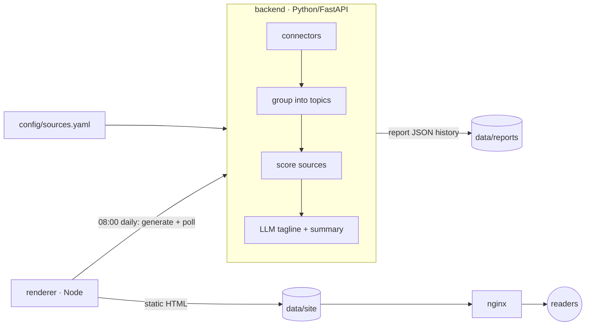

# news
A news aggregator inspired by https://news.dws.rip, offering a periodically rendered summary of what is going on in chosen areas.

## How it works



1. **Collect**: every source in `config/sources.yaml` is fetched by a connector (`backend/app/connectors/`). RSS ships today. Other source types (Twitter/X, JSON APIs) subclass `Connector` and register a new `type`.
2. **Group**: articles are bucketed into topics. The `keywords` method applies manual rules from the config, then title-similarity clustering. The `llm` method asks the LLM to cluster, and falls back to `keywords` if that fails.
3. **Score**: each article gets a weighted mix of source reputation, recency and relevance to its topic. A topic's score is the sum of its best article from each source, so stories covered by several outlets rank higher.
4. **Summarise**: the top N sources of each top topic go to the LLM, which returns a tagline and summary. Sources are listed on the entry. If the LLM is down, the entry falls back to the top source's headline.
5. **Render**: the Node renderer turns the report into static HTML once a day at `RENDER_TIME` (local `TZ`). Every generation is kept, both as JSON (`generations/<date>/<stamp>.json` in the reports store) and as HTML under `/archive/<date>/<stamp>/`. The front page and `/reports/<date>/` always show the newest generation by `generated_at`. nginx serves the files with cache headers (pages that change are `no-cache`, so readers revalidate via ETag and see a new generation immediately) and proxies read-only `/api/` calls through a response cache.

Report layout lives only in `frontend/src/report-format/`. After changing it, run `npm run rebuild` to re-render the whole history from the stored JSON.

## Running

```sh
cp .env.example .env   # set ADMIN_TOKEN, TZ, LLM_BASE_URL / LLM_MODEL
docker network create traefik && docker network create ai   # once; production joins the existing networks
docker compose -f docker-compose.yml -f docker-compose.local.yml up -d --build
docker compose exec renderer node src/main.js generate   # force a new report now (a fresh deploy renders one on startup)
```

In production Traefik serves the site at `https://${NEWS_HOST}`; nginx publishes no host port. Locally, `docker-compose.local.yml` publishes it on `http://localhost:${HTTP_PORT:-8080}`. `config/sources.yaml` and `nginx/nginx.conf` are baked into the images built from the top-level `Dockerfile` (one stage per service), so rebuild after editing them. Report JSON and rendered HTML live in the `reports` and `site` named volumes (not `data/`), which survive `docker compose down` but not `down -v`. Any OpenAI-compatible endpoint works for the LLM, e.g. Ollama at `http://host.docker.internal:11434/v1`.

## Development

```sh
python3 -m venv .venv && .venv/bin/pip install -r backend/requirements-dev.txt
(cd backend && ../.venv/bin/python -m pytest)
(cd frontend && npm test)          # Node >= 20, no npm dependencies
docker compose build && docker build -f Dockerfile.test --target backend .   # CI checks (or --target renderer)

set -a; . ./.env; set +a
(cd backend && ../.venv/bin/uvicorn app.main:create_app --factory --port 8000)
(cd frontend && npm run generate)  # writes data/site/
```

### API

| Method | Path | |
| --- | --- | --- |
| GET | `/api/reports` | stored report dates, newest first |
| GET | `/api/reports/latest`, `/api/reports/{date}` | report JSON |
| GET | `/api/reports/{date}/generations` | generation stamps for a date (`YYYYMMDDTHHMMSSZ`, UTC), newest first |
| GET | `/api/reports/{date}/generations/{stamp}` | one generation's report JSON |
| POST | `/api/reports/generate` | start generation (`X-Admin-Token`); blocked at nginx |
| GET | `/api/jobs/generate` | generation status |

Generation is blocked at nginx, so call the backend directly from a container on the `news` network (the backend image has no curl):

```sh
set -a; . ./.env; set +a   # loads ADMIN_TOKEN
docker run --rm --network news curlimages/curl -sS -X POST -H "X-Admin-Token: $ADMIN_TOKEN" http://pws-news-backend:8000/api/reports/generate
docker run --rm --network news curlimages/curl -sS http://pws-news-backend:8000/api/jobs/generate
```

Against a backend started with `uvicorn` (see Development), use `http://localhost:8000` with plain `curl`. Each generation becomes that date's current report; earlier ones stay in its history. The renderer checks `/api/reports/latest` every `RENDER_WATCH_SECONDS` (default 60) and re-renders when `generated_at` changes, so the site picks up the new report within a minute. `docker exec pws-news-renderer node src/main.js generate` generates and renders in one step instead.

## CI/CD (Jenkins)

`Jenkinsfile` builds and deploys the stack with `docker compose` on the Jenkins agent: checkout → preflight → build images → lint/tests (`Dockerfile.test`, on top of the built images) → teardown → deploy → health check → smoke test via nginx. It reports every build to Discord.

Non-secret runtime settings (`TZ`, `NEWS_HOST`, `LLM_*`) are set in the `environment {}` block. Each build writes `.env` from them. Jenkins credentials (Secret text) the job needs:

| Credential ID | Used as |
| --- | --- |
| `news-admin-token` | `ADMIN_TOKEN` |
| `llama_cpp-llm-api-key` | `LLM_API_KEY` (any placeholder works for Ollama) |
| `discord-pws-builds-channel-webhook` | Discord webhook for build alerts |

The agent needs Docker with the buildx and compose plugins, the Discord Notifier plugin, and the external `traefik` (the site is routed by Traefik at `NEWS_HOST`) and `ai` (where `llm-server` lives) docker networks. Jenkins can run in a container against the host's docker daemon: checks are built by `Dockerfile.test` on top of the deploy images (sources travel as the build context, and cached layers skip unchanged dependency installs and tests), and the stack uses no host bind mounts. Report history lives in the `pws-news_reports` and `pws-news_site` docker volumes, so wiping the workspace is safe; never run `docker compose down -v` on the agent.
