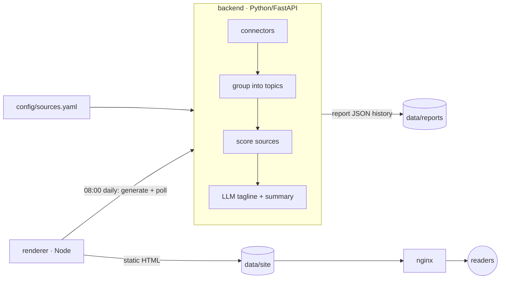

# news
A news aggregator inspired by https://news.dws.rip, offering a periodically rendered summary of what is going on in chosen areas.

## How it works



1. **Collect**: every source in `config/sources.yaml` is fetched by a connector (`backend/app/connectors/`). RSS ships today. Other source types (Twitter/X, JSON APIs) subclass `Connector` and register a new `type`.
2. **Group**: articles are bucketed into topics. The `keywords` method applies manual rules from the config, then title-similarity clustering. The `llm` method asks the LLM to cluster, and falls back to `keywords` if that fails.
3. **Score**: each article gets a weighted mix of source reputation, recency and relevance to its topic. A topic's score is the sum of its best article from each source, so stories covered by several outlets rank higher.
4. **Summarise**: the top N sources of each top topic go to the LLM, which returns a tagline and summary. Sources are listed on the entry. If the LLM is down, the entry falls back to the top source's headline.
5. **Render**: the Node renderer turns the report into static HTML once a day at `RENDER_TIME` (local `TZ`). Every rendering is kept under `data/site/reports/<date>/`. nginx serves the files with cache headers and proxies read-only `/api/` calls through a response cache.

Report layout lives only in `frontend/src/report-format/`. After changing it, run `npm run rebuild` to re-render the whole history from the stored JSON.

## Running

```sh
cp .env.example .env   # set ADMIN_TOKEN, TZ, LLM_BASE_URL / LLM_MODEL
docker compose up -d --build
docker compose exec renderer node src/main.js generate   # first render now instead of waiting for 08:00
```

The site is served on `http://localhost:${HTTP_PORT}`. Any OpenAI-compatible endpoint works for the LLM, e.g. Ollama at `http://host.docker.internal:11434/v1`.

## Development

```sh
python3 -m venv .venv && .venv/bin/pip install -r backend/requirements-dev.txt
(cd backend && ../.venv/bin/python -m pytest)
(cd frontend && npm test)          # Node >= 20, no npm dependencies

set -a; . ./.env; set +a
(cd backend && ../.venv/bin/uvicorn app.main:create_app --factory --port 8000)
(cd frontend && npm run generate)  # writes data/site/
```

### API

| Method | Path | |
| --- | --- | --- |
| GET | `/api/reports` | stored report dates, newest first |
| GET | `/api/reports/latest`, `/api/reports/{date}` | report JSON |
| POST | `/api/reports/generate` | start generation (`X-Admin-Token`); blocked at nginx |
| GET | `/api/jobs/generate` | generation status |
