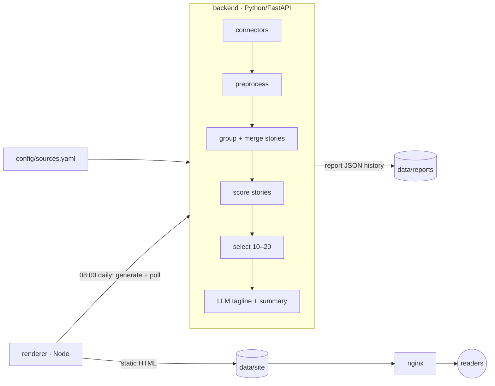

# news
A news aggregator inspired by https://news.dws.rip, offering a periodically rendered summary of what is going on in chosen areas.

## How it works



Steps 1–5 build the context (`build_context` in `backend/app/pipeline/run.py`); step 5 is where the LLM writes the report (`write_entries`).

1. **Collect**: every source in `config/sources.yaml` is fetched by a connector (`backend/app/connectors/`). RSS ships today; it also keeps one image per item (widest `media:content`, else a `media:thumbnail`, an image enclosure or the first `` in the item HTML). Other source types (Twitter/X, JSON APIs) subclass `Connector` and register a new `type`.
2. **Preprocess**: drops stale items, caps items per source, and keeps one copy of each article (by URL, ignoring tracking params; the most reputable feed's copy wins). It also annotates each article with the derived fields later stages share. This step only limits what goes into the context.
3. **Group**: articles are bucketed into topics. The `keywords` method applies manual rules from the config, then title-similarity clustering. The `llm` method asks the LLM to cluster, and falls back to `keywords` if that fails. Topics that cover the same story are then merged, so each story is one report entry whose sources may come from several groups. Topics merge on a shared URL, or when their TF-IDF vectors (titles + summaries, with each feed's boilerplate removed) reach `grouping.merge_threshold`, share at least three distinctive words, and at least one pair of their articles also reaches the threshold on its own (so a broad topic can't absorb an article that only shares its theme). These comparison keys are derived fields; headlines, summaries and links pass to the report unchanged.
4. **Score**: each article gets a weighted mix of source reputation, recency and relevance to its topic. Each story then gets a weighted mix (`scoring.story.weights`) of three signals, each 0..1, so a score means the same thing every day: *coverage* (how many outlets carry it, reputation-weighted, with diminishing returns: `coverage_half` weighted sources earn half the credit), *lead* (its best article's score) and *breadth* (how many sections' outlets cover it). With the shipped config a well-sourced single-outlet story scores about 0.4, two outlets about 0.5–0.55, three or more 0.6 and up.
5. **Select** (`backend/app/pipeline/selection.py`): between `report.min_entries` and `max_entries` stories. A story's section is the most common first tag of its sources. First each section's best story gets in, so every section is covered (`cover_sections`). The rest fill by score, at most `max_entries_per_tag` per section. Past `min_entries`, each further story must clear a cutoff that rises linearly from `cutoff_start` to `cutoff_end` at `max_entries`, and selection stops at the first that falls short. A busy day gets a longer report and a quiet one a shorter one. The `Select:` log line gives the count, the section leads and the reason selection stopped; tune the weights and cutoffs against it.
6. **Summarise**: the top N sources of each selected story go to the LLM, which returns a tagline and summary. Sources are listed on the entry, each with its `image_url` when the feed had one. If the LLM is down, the entry falls back to the top source's headline.
7. **Render**: the Node renderer turns the report into static HTML once a day at `RENDER_TIME` (local `TZ`). Every generation is kept, both as JSON (`generations/<date>/<stamp>.json` in the reports store) and as HTML under `/archive/<date>/<stamp>/`. The front page and `/reports/<date>/` always show the newest generation by `generated_at`. nginx serves the files with cache headers (pages that change are `no-cache`, so readers revalidate via ETag and see a new generation immediately) and proxies read-only `/api/` calls through a response cache.

Each entry shows the image of its first source that has one, hot-linked from the publisher (no-referrer, lazy, removed if it fails to load). Report layout lives only in `frontend/src/report-format/`. After changing it, run `npm run rebuild` to re-render the whole history from the stored JSON.

## Running

```sh
cp .env.example .env   # set ADMIN_TOKEN, TZ, LLM_BASE_URL / LLM_MODEL
docker network create traefik && docker network create ai   # once; production joins the existing networks
docker compose -f docker-compose.yml -f docker-compose.local.yml up -d --build
docker compose exec renderer node src/main.js generate   # force a new report now (a fresh deploy renders one on startup)
```

In production Traefik serves the site at `https://${NEWS_HOST}`; nginx publishes no host port. Locally, `docker-compose.local.yml` publishes it on `http://localhost:${HTTP_PORT:-8080}`. `config/sources.yaml` and `nginx/nginx.conf` are baked into the images built from the top-level `Dockerfile` (one stage per service), so rebuild after editing them. Report JSON and rendered HTML live in the `reports` and `site` named volumes (not `data/`), which survive `docker compose down` but not `down -v`. Any OpenAI-compatible endpoint works for the LLM, e.g. Ollama at `http://host.docker.internal:11434/v1`.

## Development

```sh
python3 -m venv .venv && .venv/bin/pip install -r backend/requirements-dev.txt
(cd backend && ../.venv/bin/python -m pytest)
(cd frontend && npm test)          # Node >= 20, no npm dependencies
docker compose build && docker build -f Dockerfile.test --target backend .   # CI checks (or --target renderer)

set -a; . ./.env; set +a
(cd backend && ../.venv/bin/uvicorn app.main:create_app --factory --port 8000)
(cd frontend && npm run generate)  # writes data/site/
```

### Tuning the merge step

`backend/tests/data/merge/` holds labeled same-story pairs from real feeds (`<day>.labels.yaml`, written by hand) and the fixture built from them (`<day>.json`). `backend/tests/test_merge_eval.py` fails if the configured thresholds merge fewer same-story pairs or more different-story pairs than the recorded baseline. To compare thresholds or an embedding model:

```sh
cd backend
../.venv/bin/python -m tests.merge_eval eval tests/data/merge/2026-11-03.json
LLM_BASE_URL=http://localhost:11434/v1 ../.venv/bin/python -m tests.merge_eval eval tests/data/merge/2026-11-03.json --embeddings nomic-embed-text
../.venv/bin/python -m tests.merge_eval snapshot <dir of saved <source id>.xml feeds> tests/data/merge/<day>.labels.yaml
```

`--embeddings` fetches the labeled articles' embeddings once and caches them in `tests/data/merge/embeddings/`, so the test suite can check a configured model offline. Tests only read `tests/data/`; nothing touches `data/`.

### API

| Method | Path | |
| --- | --- | --- |
| GET | `/api/reports` | stored report dates, newest first |
| GET | `/api/reports/latest`, `/api/reports/{date}` | report JSON |
| GET | `/api/reports/{date}/generations` | generation stamps for a date (`YYYYMMDDTHHMMSSZ`, UTC), newest first |
| GET | `/api/reports/{date}/generations/{stamp}` | one generation's report JSON |
| POST | `/api/reports/generate` | start generation (`X-Admin-Token`); blocked at nginx |
| GET | `/api/jobs/generate` | generation status; blocked at nginx |
| GET | `/metrics` | Prometheus metrics; not proxied by nginx (see Metrics) |

Generation and its status are blocked at nginx, so call the backend directly from a container on the `news` network (the backend image has no curl):

```sh
set -a; . ./.env; set +a   # loads ADMIN_TOKEN
docker run --rm --network news curlimages/curl -sS -X POST -H "X-Admin-Token: $ADMIN_TOKEN" http://pws-news-backend:8000/api/reports/generate
docker run --rm --network news curlimages/curl -sS http://pws-news-backend:8000/api/jobs/generate
```

Against a backend started with `uvicorn` (see Development), use `http://localhost:8000` with plain `curl`. Each generation becomes that date's current report; earlier ones stay in its history. The renderer checks `/api/reports/latest` every `RENDER_WATCH_SECONDS` (default 60) and re-renders when `generated_at` changes, so the site picks up the new report within a minute. `docker exec pws-news-renderer node src/main.js generate` generates and renders in one step instead.

## Metrics

The backend serves Prometheus metrics at `GET /metrics` on port 8000 (`backend/app/metrics.py`, via `prometheus-client`). nginx only proxies `/api/`, so the endpoint isn't public. Prometheus scrapes it from a docker network it shares with `pws-news-backend`:

```yaml
scrape_configs:
  - job_name: pws-news
    static_configs:
      - targets: ["pws-news-backend:8000"]
```

Grafana then reads the series from that Prometheus data source. Besides the default `process_*` and `python_*` series:

| Metric | Type | Labels |
| --- | --- | --- |
| `news_generation_runs_total` | counter | `outcome` (`success`/`failure`) |
| `news_generation_duration_seconds` | histogram | |
| `news_generation_last_success_timestamp_seconds` | gauge | |
| `news_report_entries` | gauge, last report | `writer` (`llm`/`fallback`) |
| `news_source_fetches_total` | counter | `source`, `outcome` |
| `news_source_items` | gauge, last generation | `source` |
| `news_llm_requests_total` | counter | `operation` (`chat`/`embed`), `outcome` |
| `news_llm_request_duration_seconds` | histogram | `operation` |

Useful queries: `time() - news_generation_last_success_timestamp_seconds` (alert when it passes ~25h), `increase(news_source_fetches_total{outcome="failure"}[1d])`, `histogram_quantile(0.95, rate(news_llm_request_duration_seconds_bucket[1h]))`.

## CI/CD (Jenkins)

`Jenkinsfile` builds and deploys the stack with `docker compose` on the Jenkins agent: checkout → preflight → build images → lint/tests (`Dockerfile.test`, on top of the built images) → teardown → deploy → health check → smoke test via nginx. It reports every build to Discord.

Non-secret runtime settings (`TZ`, `NEWS_HOST`, `LLM_*`) are set in the `environment {}` block. Each build writes `.env` from them. Jenkins credentials (Secret text) the job needs:

| Credential ID | Used as |
| --- | --- |
| `news-admin-token` | `ADMIN_TOKEN` |
| `llama_cpp-llm-api-key` | `LLM_API_KEY` (any placeholder works for Ollama) |
| `discord-pws-builds-channel-webhook` | Discord webhook for build alerts |

The agent needs Docker with the buildx and compose plugins, the Discord Notifier plugin, and the external `traefik` (the site is routed by Traefik at `NEWS_HOST`) and `ai` (where `llm-server` lives) docker networks. Jenkins can run in a container against the host's docker daemon: checks are built by `Dockerfile.test` on top of the deploy images (sources travel as the build context, and cached layers skip unchanged dependency installs and tests), and the stack uses no host bind mounts. Report history lives in the `pws-news_reports` and `pws-news_site` docker volumes, so wiping the workspace is safe; never run `docker compose down -v` on the agent.
